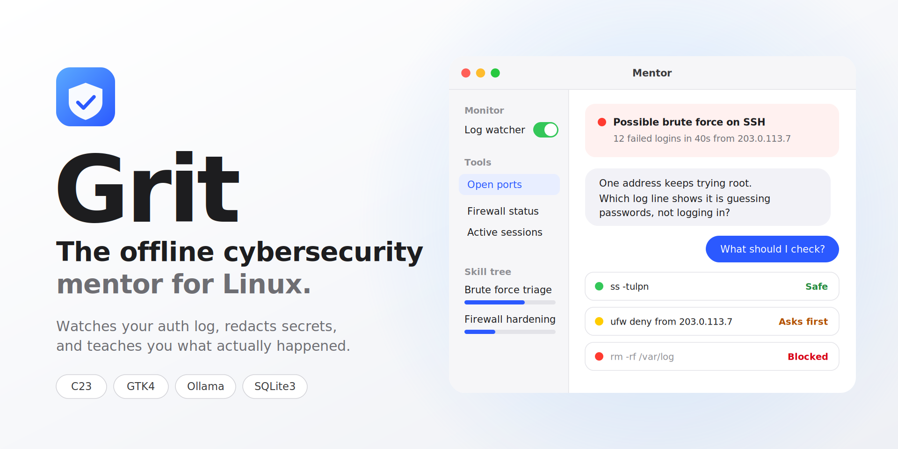

# Grit — Offline Cybersecurity Mentor & Autonomous Log Agent

[](https://en.wikipedia.org/wiki/C23_(C_standard_revision))
[]()
[](https://gtk.org/)
[](https://ollama.ai/)
[]()

**Grit** is a privacy-first, offline cybersecurity mentor desktop application and autonomous log agent designed for Linux systems. Built with a high-performance **C23 POSIX systems layer** and a **GTK4 / Libadwaita front-end**, Grit continuously monitors Linux authentication logs (`/var/log/auth.log`) using native `inotify`. It sanitizes private credentials in real-time, surfaces attack anomalies, and engages the user through an interactive **Socratic cybersecurity mentor chat** backed by local Ollama LLMs (`qwen2.5:1.5b`, `qwen2.5:3b`, `qwen2.5-coder`, `deepseek-r1`).

The mentor acts as an intelligent agent: it explains what happened in plain terms, guides the student through investigative steps, executes safe observational diagnostic tools (`ss -tulpn`, `tail /var/log/auth.log`, `ufw status`), and strictly gates state-modifying actions behind the **Command Guard** safety tree.

---

## Architecture Overview

```
                      +-------------------------------------------------------------+
                      |         Grit Socratic Mentor Agent Desktop GUI              |
                      |   (GTK4 / Libadwaita — PyGObject + C23 libgrit.so)          |
                      |                                                             |
                      |  [Left Sidebar: Monitor & Tools]    [Right Panel: Socratic] |
                      |  - Inotify Watcher Toggle Switch    - Proactive Alert Stream|
                      |  - Attack Simulation Buttons        - Multi-turn LLM Chat   |
                      |  - Agent Diagnostic Tool Runners    - Suggested Commands    |
                      |  - Ollama Model Selector (/api/tags)- CommandGuard Badges   |
                      |  - Gamified Analyst Skill Tree      - Caution Confirmations |
                      +------------------------------+------------------------------+
                                                     |
                                    +----------------+---------------+
                                    |   C23 POSIX Engine (libgrit.so)|
                                    +----------------+---------------+
                                                     |
                      +------------------------------+------------------------------+
                      |                        WatcherContext                       |
                      |  - is_running: atomic_bool                                  |
                      |  - inotify_fd: Linux file monitor                           |
                      |  - event_fd: 0ms shutdown interrupt                         |
                      +--------------+-------------------------------+--------------+
                                     |                               |
               poll(inotify_fd)      |                               | poll(event_fd)
            +------------------------+                               +--------------+
            |                                                                       |
            v                                                                       v
     [File Event]                                                           [Instant Stop]
            |                                                                       |
            v                                                                       v
     [Redaction Engine]                                                     Thread halts
       - Strips PEM Keys     -> <REDACTED>                                  cleanly (<1ms)
       - Strips Passwords    -> <REDACTED>
       - Strips JWTs         -> <REDACTED>
            |
            v
     [Incident Dispatched to Observer Callback]
            |
            v
     [Socratic Proactive LLM Query via Ollama]
            |
            v
     [Command Guard Classification]
       - 🟢 CMD_SAFE    (Read-only observational commands: ss, ps, journalctl)
       - 🟡 CMD_CAUTION (State-modifying operations: kill, ufw, chmod)
       - 🔴 CMD_BLOCKED (Destructive commands & shell injections: rm, dd, | bash)
            |
            v
     [SQLite3 Persistence & Gamified Analyst XP Engine]
```

---

## Core Capabilities

### 1. Interactive Socratic Mentor & Agent GUI
- **Proactive Attack Notifications**: When inotify captures a brute force probe or privilege escalation, the app automatically posts an incident card in the chat stream with sanitized excerpts and triggers the mentor to explain the attack technique.
- **Autonomous Agent Diagnostic Tools**:
  - `ss -tulpn`: Inspect active listening network sockets and process bindings.
  - `tail auth.log`: Audit recent authentication events.
  - `ufw status` / `iptables -L`: Audit host firewall configuration and active rules.
  - `who`: Audit active interactive user sessions.
- **Model Auto-Discovery**: Automatically queries `http://127.0.0.1:11434/api/tags` to populate all locally installed Ollama models (e.g. `qwen2.5:1.5b`, `qwen2.5:3b`, `deepseek-r1:7b`).
- **Offline Socratic Fallback**: If Ollama is offline or unavailable, Grit's built-in heuristic Socratic engine immediately takes over, ensuring unbroken learning.

### 2. Zero-Latency Thread State Machine (`poll()` + `eventfd`)
- Background watcher monitors `inotify_fd` and `event_fd` concurrently using POSIX `poll()`.
- Thread interrupt via `watcher_stop()` completes in **~413 µs to 670 µs**, ensuring zero UI freezing.

### 3. Real-Time Credential Redaction Engine
- Strips PEM private keys (`-----BEGIN ... PRIVATE KEY-----`).
- Strips cleartext passwords (`password=...`, `passwd:...`).
- Strips JSON Web Tokens (`eyJ...`).
- Replaces sensitive tokens with `<REDACTED>` before storage or transmission to LLM.

### 4. Defensive Command Guard (Safety Tree)
- Every terminal command generated by the LLM or suggested in triage is evaluated against an allowlist/denylist:
  - 🟢 **`CMD_SAFE`**: Read-only verification (`ss`, `ps`, `cat`, `grep`, `journalctl`, `systemctl status`, `ufw status`). Features a 1-click **Copy Command** button.
  - 🟡 **`CMD_CAUTION`**: State-modifying operations (`kill`, `chmod`, `systemctl restart`, `ufw deny/allow`). Requires user confirmation in an Adw alert dialog before copying.
  - 🔴 **`CMD_BLOCKED`**: Destructive binaries (`rm`, `rmdir`, `dd`, `mkfs.*`, `fdisk`, `shred`), subshells, and pipes to interpreters (`| bash`). Explicitly disabled with an injection hazard tooltip.
- Strict observational design: **no unchecked shell executions (`system()`, `popen()`, `exec()`) exist.**

### 5. Gamified Skill Tree Progression (SQLite3 WAL)
- Persistent SQLite3 database with XDG compliance (`~/.local/share/grit/grit.db`).
- Tracks XP and calculates virtual levels (`level = xp / 100`) across defensive domains:
  - `Brute Force Triage`
  - `Privilege Escalation`
  - `Credential Hygiene`
  - `Network Auditing`
  - `Firewall Hardening`

---

## File Structure

| Path | Purpose |
|---|---|
| [**`run.sh`**](run.sh) | Automated build and runner script for GUI, simulations, and test suites |
| [**`src/gui/mentor_agent_app.py`**](src/gui/mentor_agent_app.py) | **Primary Desktop GUI**: Socratic Mentor Chat & Autonomous Agent Log Monitor |
| [**`src/gui/app.py`**](src/gui/app.py) | Classic Incident Triage & Tabbed Monitor Desktop GUI |
| [**`src/main.c`**](src/main.c) | Native GTK4 pure C desktop application implementation |
| [**`src/core/types.h`**](src/core/types.h) | Shared domain types (`Incident`, `CommandSafety`, `MentorResponse`, etc.) |
| [**`src/core/watcher.h`**](src/core/watcher.h) | Watcher prototypes and `WatcherContext` struct definition |
| [**`src/core/watcher.c`**](src/core/watcher.c) | Inotify + eventfd polling loop and POSIX regex redaction engine |
| [**`src/core/simulator.h`**](src/core/simulator.h) | Attack scenario simulation engine header |
| [**`src/core/simulator.c`**](src/core/simulator.c) | Attack scenario injector (`SCENARIO_SSH_BRUTE`, `SCENARIO_SUDO_ESCALATION`, etc.) |
| [**`src/mentor/command_guard.h`**](src/mentor/command_guard.h) | Command guard evaluation prototypes |
| [**`src/mentor/command_guard.c`**](src/mentor/command_guard.c) | Explicit allowlist/denylist safety classification tree |
| [**`src/mentor/llm_client.h`**](src/mentor/llm_client.h) | Multi-turn Ollama orchestration client header |
| [**`src/mentor/llm_client.c`**](src/mentor/llm_client.c) | Asynchronous libcurl worker thread & GTK idle bridge |
| [**`src/db/db.h`**](src/db/db.h) | SQLite3 persistence & skill tree engine header |
| [**`src/db/db.c`**](src/db/db.c) | SQLite3 WAL implementation with prepared statements and virtual levels |
| [**`src/db/schema.sql`**](src/db/schema.sql) | Relational database schema with foreign keys and cascade deletes |
| [**`tests/test_full_pipeline.c`**](tests/test_full_pipeline.c) | Complete end-to-end architecture pipeline verification suite |
| [**`tests/test_watcher_guard.c`**](tests/test_watcher_guard.c) | Inotify, eventfd interrupt, and redaction test suite |
| [**`tests/test_llm_client.c`**](tests/test_llm_client.c) | Ollama JSON payload, parser, and async thread test suite |
| [**`CMakeLists.txt`**](CMakeLists.txt) | C23 build system configuration (GTK4, SQLite3, libcurl, pthreads) |
| [**`ACHIEVMENT.md`**](ACHIEVMENT.md) | Technical achievement summary and benchmark verification matrix |

---

## Quickstart & Usage

### 1. Launch the Socratic Mentor Agent GUI (Default)
Compiles `libgrit.so` automatically and starts the Mentor Agent desktop application:
```bash
./run.sh
# or explicitly:
./run.sh agent
```

### 2. Launch the Classic Incident Triage GUI
```bash
./run.sh triage
```

### 3. Run the Verification Test Suite
Builds and executes all three C23 test suites under strict compiler flags:
```bash
./run.sh --test
```

### 4. Inject Attack Scenarios (Headless Simulation)
Test detection and log monitoring without the GUI:
```bash
# Available scenarios: ssh_brute | sudo_abuse | redaction_test
./run.sh --simulate ssh_brute
```

### 5. Run Headless Log Monitor Daemon
```bash
./run.sh --headless /var/log/auth.log
```

### 6. Clean Build Artifacts
```bash
./run.sh --clean
```

---

## Local Ollama LLM Setup (Recommended)

Grit automatically communicates with local Ollama instances at `http://127.0.0.1:11434`.

To install and run models locally:
```bash
# Pull lightweight models suitable for fast local inference:
ollama pull qwen2.5:1.5b
ollama pull qwen2.5:3b
ollama pull deepseek-r1:7b
```
When launched, Grit auto-detects these models in the drop-down selector. If Ollama is not running, Grit falls back to its built-in offline Socratic tutor seamlessly.

---

## Desktop Integration & Application Icon

Grit includes a high-definition Freedesktop / GNOME HIG compliant application icon and desktop launcher:

- **Scalable Vector Icon**: [`data/icons/hicolor/scalable/apps/org.grit.workstation.svg`](data/icons/hicolor/scalable/apps/org.grit.workstation.svg)
- **High-Resolution PNG Icons**: Multi-resolution renders (16px to 512px) in `data/icons/hicolor/<size>/apps/`
- **Desktop Entry**: [`data/org.grit.workstation.desktop`](data/org.grit.workstation.desktop)
- **Four Workstation Modes**:
  1. 💬 **Mentor**: Interactive Socratic dialogue, proactive incident alerts, 1-click safe command runner, and Command Guard badges.
  2. 🛡️ **Log Triage**: Dedicated live security stream, KPI metric cards, and an interactive C23 credential redaction sandbox.
  3. 🎖️ **Defense Matrix**: Gamified cyber analyst ranking, XP progress bars, and achievement trophy badges.
  4. ⚡ **Simulator Lab**: Linux attack scenario injectors (`ssh_brute`, `sudo_abuse`, `credential_leak`), diagnostic suite, and POSIX microsecond latency benchmark.

